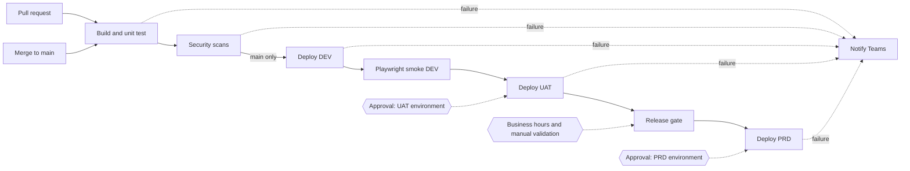
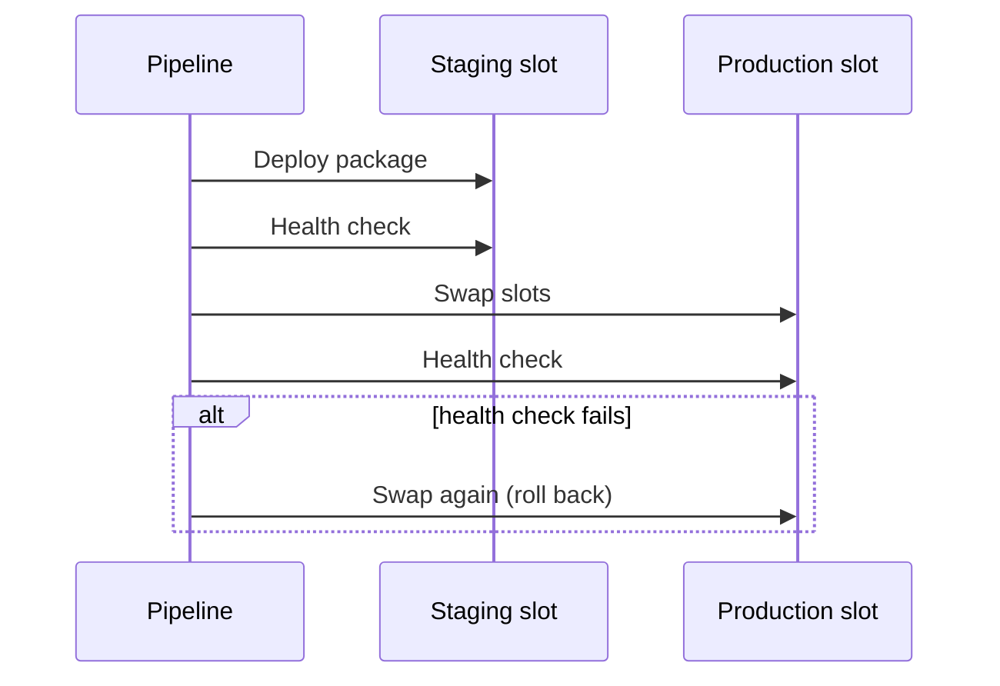
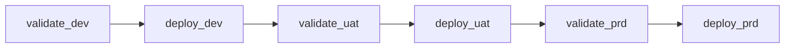

# Promotion flow

The web app example (`examples/web-app-pipeline.yml`) promotes one build artifact through every environment.
Nothing is rebuilt between environments.

Pull requests stop after the scan stage. Deploy stages only run for non-PR builds.

Each App Service deployment runs this sequence inside its environment:

The infrastructure example follows the same pattern with Bicep. For each environment, `validate_<env>` runs build, lint and
what-if without any approval, then `deploy_<env>` waits for the environment approval.

